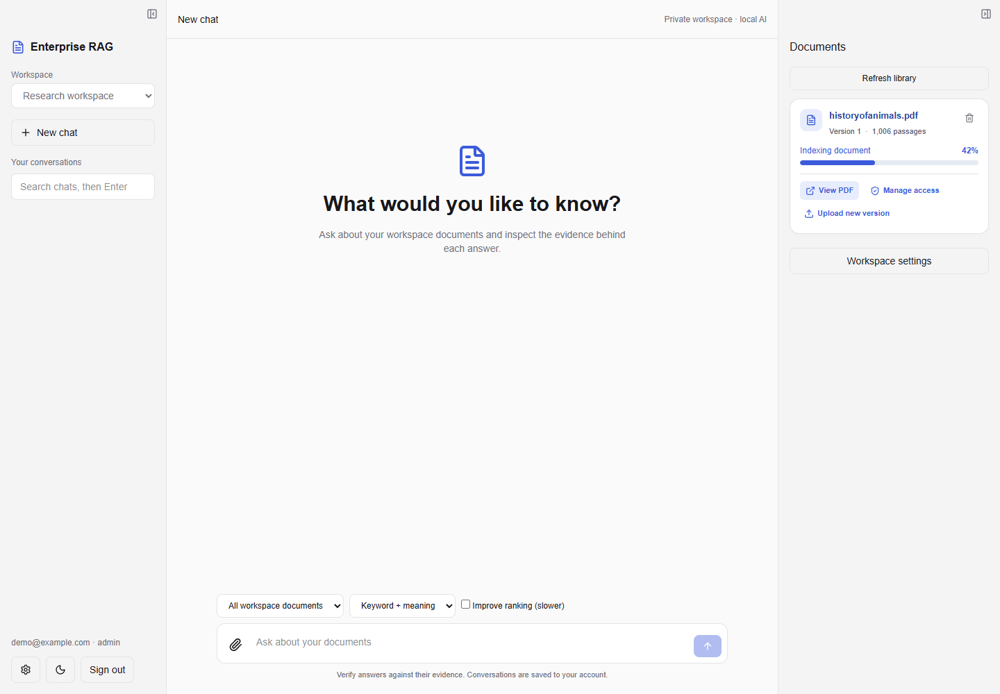
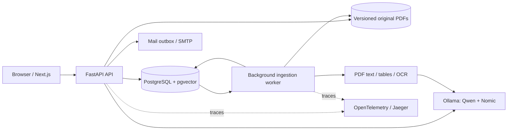
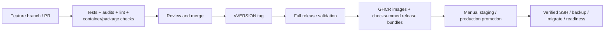

<div align="center">

# Enterprise RAG

**A local AI workspace for asking questions about PDFs and inspecting the evidence.**


[Quick start](#quick-start) · [Features](#features) · [Benchmarks](#measured-benchmarks) · [Testing](#testing) · [CI/CD](#cicd-and-releases) · [Deployment guide](deploy/DEPLOYMENT.md)

<picture>
  <source media="(prefers-color-scheme: dark)" srcset="docs/images/workspace-dark.png">
  
</picture>

<sub>Interface preview uses demonstration account/document metadata. Benchmark scores below come from the separate measured synthetic pilot.</sub>

</div>

---

## Purpose

Enterprise RAG turns a collection of PDFs into a searchable, conversational knowledge workspace. Upload a handbook, report or reference document, ask a question or follow-up, and inspect the passages and physical PDF pages behind the response.

It uses **retrieval-augmented generation (RAG)**: permission-filtered search selects relevant document passages before a local language model produces an answer. PostgreSQL stores the application records and vectors; Ollama runs generation and embeddings. Document content can stay within infrastructure you operate, without a paid external model evaluator.

The project is a self-hostable engineering foundation with tested access controls, durable ingestion, observable services and reproducible evaluation tooling. Answer quality still needs human review and a representative domain benchmark before consequential use.

## Contents

- [Features](#features)
- [Architecture and tools](#architecture-and-tools)
- [Quick start](#quick-start)
- [Using the workspace](#using-the-workspace)
- [Measured benchmarks](#measured-benchmarks)
- [Testing](#testing)
- [CI/CD and releases](#cicd-and-releases)
- [Repository structure](#repository-structure)
- [Operations and troubleshooting](#operations-and-troubleshooting)
- [Documentation and remaining work](#documentation-and-remaining-work)

## Features

| Area | Implemented behavior |
| --- | --- |
| Document chat | Streamed Markdown answers, contextual follow-ups, document filters, page citations and original-PDF viewer |
| Retrieval | Vector search and PostgreSQL full-text search, reciprocal rank fusion, duplicate suppression and optional model reranking |
| Accounts | Local registration, email verification, password recovery, invitations, revocable cookie sessions and CSRF/origin checks |
| Access | Admin/editor/reader workspaces, restrictive document permissions, PostgreSQL row policies and evidence redaction after revoked access |
| Ingestion | Retained original PDFs, checksums, version history, durable jobs, leases/heartbeats/retries and atomic index publication |
| PDF extraction | Native text, English scanned-page OCR, table extraction and saved extraction diagnostics |
| Workspace UI | Light/dark themes, resizable/collapsible desktop panels, mobile document drawer, indexing bars with percentages and clear status colors |
| Conversations | Server persistence, private chat history, search/pinning, Markdown export, print/PDF and answer feedback |
| Identity integration | Optional Authlib/OIDC login with Keycloak example configuration; MFA is managed by the identity provider |
| Operations | Health/readiness endpoints, structured logs, audit records, protected metrics, OpenTelemetry traces and backup/recovery tools |
| Evaluation | Four-configuration comparisons, final-context ranking metrics, evidence/citation checks, OCR/tables, optional local judging and human review |
| Delivery | Feature-branch/PR tests, container builds, version checks, checksummed packages, GHCR release images and manual SSH promotion |

PDF uploads are limited to 50 MB. The current vector schema requires 768-dimensional embeddings; changing to another embedding dimension requires a schema change and reindexing. English OCR is included; DOCX/PPTX parsing and Microsoft source connectors remain future work. A local incremental folder connector is available in `tools/sync_folder.py`.

## Architecture and tools



Production places Nginx in front of Next.js and FastAPI, exposing `/api` on the same origin. The API runs with a restricted database role; migration and ingestion use separate roles. A replacement document version becomes searchable only when indexing completes.

| Layer | Tools |
| --- | --- |
| Web | Next.js 16.4, React 19, TypeScript, Tailwind CSS 4, Lucide, React Markdown |
| API | Python 3.12, FastAPI, Pydantic, Uvicorn, Psycopg |
| Retrieval / models | PostgreSQL 16, pgvector, LangChain components, Ollama, Qwen 2.5 7B, Nomic Embed Text |
| PDF processing | pypdf, pdfplumber, Poppler, Tesseract OCR, Pillow |
| Identity / mail | Scrypt, opaque sessions, Authlib/OIDC, optional Keycloak, Mailpit for local mail |
| Observability | OpenTelemetry, Jaeger, Prometheus configuration and alert rules |
| Testing / delivery | unittest, Node test runner, Playwright, ESLint, pip-audit, npm audit, actionlint, ShellCheck, Docker Buildx, GitHub Actions / GHCR |

Dependency versions are recorded in `backend/requirements.lock` and `frontend/package-lock.json`. Runtime images use non-root users; release images include OCI version/revision labels and BuildKit provenance/SBOM attestations.

## Quick start

### Prerequisites

- Docker Desktop or Docker Engine with the Compose plugin.
- Python 3.12 for setup and local verification tools.
- Ollama installed and running on the host or an accessible private server.
- Node.js 22 only if running frontend checks or developing outside its Docker container.

The commands below use VS Code's **PowerShell** terminal. Replace `<YOUR_REPOSITORY_SSH_URL>` with your repository URL when it is available.

```powershell
git clone <YOUR_REPOSITORY_SSH_URL> enterprise-rag
cd enterprise-rag

# Fresh checkout only: create local configuration and generate private credentials.
Copy-Item .env.example .env
python tools/setup_env.py

# Start Ollama first, then install the models used by this configuration.
ollama pull qwen2.5:7b-instruct
ollama pull nomic-embed-text

docker compose up -d --build
```

For an existing installation, keep your current `.env`; `tools/setup_env.py` preserves existing real values. Database volumes and retained PDFs persist across normal container restarts. Do not run `reset_db.py` or delete volumes to start the app.

| Service | Local address |
| --- | --- |
| Workspace | [localhost:3000](http://localhost:3000) |
| API documentation | [localhost:8000/docs](http://localhost:8000/docs) |
| Readiness | [localhost:8000/health/ready](http://localhost:8000/health/ready) |
| Local verification/reset mail | [localhost:8025](http://localhost:8025) |
| Traces | [localhost:16686](http://localhost:16686) |

Sign in with `BOOTSTRAP_ADMIN_EMAIL` and `BOOTSTRAP_ADMIN_PASSWORD` from your private `.env`. Bootstrap configuration creates the initial account on a fresh database; changing it later does not reset an existing account password. New users can register and use the verification link captured in Mailpit.

**Docker Compose already runs the frontend. You do not need `npm run dev` after starting the full stack.** The first answer may take several minutes while the model loads; the synthetic pilot observed a 124-second initial request. Readiness distinguishes installed models from `generation_model_loaded`.

<details>
<summary><strong>Frontend development directly in VS Code</strong></summary>

Keep the Docker backend/database/worker running and stop its frontend before using port 3000 locally:

```powershell
docker compose stop frontend
cd frontend
npm.cmd ci
npm.cmd run dev
```

The frontend defaults to `http://localhost:8000`. Desktop Docker development uses Webpack to avoid the previously observed Windows bind-mount first-compile stall. Production uses the optimized standalone build.

</details>

### Configuration

| Setting | Purpose / default |
| --- | --- |
| `CHAT_MODEL` | `qwen2.5:7b-instruct` |
| `EMBEDDING_MODEL` | `nomic-embed-text` with the current 768-dimensional index |
| `MODEL_CONCURRENCY` | `1`; excess work receives a controlled busy response |
| `MODEL_TIMEOUT_SECONDS` | `300` |
| `MODEL_CONTEXT_SIZE` / `MODEL_MAX_TOKENS` | `4096` / `1024` |
| `OCR_ENABLED` / `OCR_MAX_PAGES` | English OCR enabled / limit 50 pages per extraction |
| `CHUNK_SIZE` / `CHUNK_OVERLAP` | `1000` / `200` characters |
| `ALLOW_REGISTRATION` | Enabled locally; disabled by default in production |

Use `.env.example` for local settings and `deploy/production.env.example` for production templates. Keep credentials in ignored environment files or your deployment secret system. On Linux, host Ollama must listen on an address reachable from the Docker bridge; see the [deployment guide](deploy/DEPLOYMENT.md).

## Using the workspace

1. Create or select a workspace. Administrators can add approved readers/editors or send invitations.
2. Attach a PDF and choose **Index**. The document card shows queued/preparing/indexing/finalizing progress and its percentage. The percentage comes from completed embedding batches; extraction can remain at 0% while a large PDF is being prepared. It is not an estimated time remaining.
3. Once indexed, ask a question and a follow-up. Select one document or search the whole permitted workspace.
4. Open a source badge to inspect the passage and original PDF page. Verify the answer against that evidence.
5. Use **Upload new version** for changes. The existing version remains searchable until the replacement is ready. A failed replacement keeps the earlier version available.
6. Drag desktop panel dividers to resize; use their buttons to collapse/expand. Preferences persist per account in the browser.

Readers cannot upload or administer documents. Document access is checked for retrieval, originals, excerpts and stored cited answers. Conversations remain private to their author. Workspace administrators can inspect aggregate operations/audit information without receiving another user's private chat history through the application API.

## Measured benchmarks

The local pilot ran on **21 October 2026**: 10 authored PDFs, 40 synthetic questions, 4 configurations, 160 scored requests, top-k 5 and one repeat. These measurements predate the delivery/UI changes and remain the engine baseline.

| Retrieval configuration | Strict fixture passes | Final Recall@5 | nDCG@5 | Warm median / p95 |
| --- | ---: | ---: | ---: | ---: |
| PostgreSQL full-text keyword search | 27/40 · 67.5% | 60.6% | 0.6061 | 0.735 / 1.096 s |
| Vector | 38/40 · 95% | 100% | 0.9955 | 0.914 / 1.113 s |
| Hybrid | 38/40 · 95% | 100% | 0.9955 | 0.930 / 1.146 s |
| Hybrid + local model reranking | 28/40 · 70% | 100% | 0.9507 | 1.211 / 1.687 s |

**These are synthetic fixture results, not human-reviewed business accuracy.** Strict passes combine fact-string, evidence, citation, refusal and injection checks. Recall uses the actual final context supplied to generation. Keyword search is PostgreSQL full-text ranking, not BM25.

Findings that affect the default configuration:

- All 160 quality requests completed without API/stream errors. Vector and hybrid tied; two answers omitted citations to required evidence pages despite retrieving the evidence.
- Reranking fell back on 12/40 requests and lowered ranking quality in this run. **Hybrid without reranking remains the default.**
- The single English scan had normalized CER/WER of 0; the single ruled table had 100% annotated cell accuracy. Complex/multilingual layouts were not evaluated.
- The security regression suite passed its account, permission/RLS, revocation, OCR provenance and recovery checks.
- The warm capacity probe completed 6/6, 3/6 and 2/6 requests at concurrency 1, 2 and 4. Other requests received HTTP 503 under the configured model limit of one.
- Eight selected hybrid answers received valid advisory local judgments after a schema correction. The answer model judged itself; human calibration count remains zero.

See [full findings and limits](BENCHMARK_RESULTS.md), [public aggregate JSON](docs/benchmarks/pilot-20261021-summary.json) and [CSV](docs/benchmarks/pilot-20261021-summary.csv). Private answers, passages and version IDs stay in ignored `output/benchmarks/`. No official BEIR, RAGBench, ALCE or OmniDocBench run is claimed.

### Repeat the benchmark

Create a local tooling environment once:

```powershell
python -m venv backend/venv
.\backend\venv\Scripts\python.exe -m pip install -r backend/requirements.lock
.\backend\venv\Scripts\python.exe -u tools/benchmark.py --fixture --security
```

Open the printed `output/benchmarks/<run>/index.html`; CSV and JSON are saved alongside it. The runner uses a separate synthetic workspace and preserves existing documents. For reviewed private datasets, repeated comparisons, optional claim judging, human review and load probes, follow [BENCHMARKING.md](BENCHMARKING.md).

## Testing

```powershell
# Backend, metric and release-package unit tests
.\backend\venv\Scripts\python.exe -m unittest discover -s backend/tests -v
python tools/version.py --check

# Live integration against your running local stack; creates isolated test records
.\backend\venv\Scripts\python.exe -u backend/smoke_test.py
.\backend\venv\Scripts\python.exe tools/test_registration.py
Start-Sleep -Seconds 61 # Respect the login/account rate window between suites.
.\backend\venv\Scripts\python.exe tools/test_enterprise_features.py

# Frontend checks
cd frontend
npm.cmd ci
npm.cmd run lint
npm.cmd test
npm.cmd run build
npm.cmd run typecheck
npx.cmd playwright install chromium
npm.cmd run test:e2e
```

Browser regressions cover login controls, document progress transitions, queue/failure states, light/dark text contrast and mobile layout/reader actions. They use a mocked API for deterministic UI checks. CI integration separately uses a real fresh PostgreSQL database, migrations, ingestion/OCR, SMTP capture, accounts and row policies with a CI-only Ollama protocol double. **That double does not measure model answer quality.**

Normal account/query limits remain enabled. Allow the login/account rate window to expire between live suites; CI includes a cooldown before the enterprise suite. Tests leave their isolated accounts/audit records available for inspection. Recovery/runtime probes and deeper operator checks are documented in [OPEN_SOURCE_FEATURES.md](OPEN_SOURCE_FEATURES.md).

## CI/CD and releases



| Workflow | Trigger | Responsibility |
| --- | --- | --- |
| `ci.yml` | Any branch push, PR, manual run, reusable call | Backend/frontend/browser tests, audits, workflow/shell lint, fresh-DB integration, image boundaries and preview packaging |
| `release.yml` | `v*` tags reachable from default branch | Version/changelog check, full CI, GHCR images, provenance/SBOM and GitHub release assets |
| `deploy.yml` | Manual run from default branch | Verified release assets, pinned SSH host key, digest-pinned images, pre-deploy backups, migrations and readiness checks |

GitHub Actions are pinned to commit hashes and updated through Dependabot. PR validation uses read-only repository permissions. Feature branches run CI and generate downloadable preview archives; production promotion uses GitHub environment secrets. Set **Required checks** as a merge requirement in repository rules.

Versioning is synchronized from the root `VERSION` file:

```powershell
python tools/version.py --set 0.2.0
# Add the matching CHANGELOG.md entry, commit and merge your feature PR.
# On the merged release commit:
git tag -a v0.2.0 -m "Enterprise RAG 0.2.0"
git push origin v0.2.0
```

Use a version appropriate to the release; the current baseline is `0.1.0`. To create and verify an unpublished local preview:

```powershell
.\backend\venv\Scripts\python.exe tools/package_release.py --output dist/preview
.\backend\venv\Scripts\python.exe tools/verify_release.py dist/preview
```

Preview bundles cannot pass the deployment gate. Released Linux amd64 bundles reference application images by digest. The source archive uses an explicit allowlist that excludes credentials, environments, user PDFs, caches and private benchmark evidence.

**VPS setup and GitHub secrets:** follow [deploy/DEPLOYMENT.md](deploy/DEPLOYMENT.md). Configure `SSH_HOST`, `SSH_USER`, `SSH_PRIVATE_KEY` and `SSH_KNOWN_HOSTS` in `staging`/`production` environments, provision the private server configuration and HTTPS ingress, then manually promote a published tag. Deployment includes a maintenance window. Database migrations are not automatically rolled back.

The workflows are implemented and locally checked; remote CI, GHCR publication and VPS deployment require your repository push and environment configuration. This workspace has no configured Git remote, and no code has been pushed by this implementation.

## Repository structure

```text
enterprise-rag/
├── .github/
│   ├── workflows/             # CI, release publishing and manual SSH deployment
│   ├── dependabot.yml
│   └── pull_request_template.md
├── backend/
│   ├── main.py                # API startup, health and request telemetry
│   ├── routers/               # Accounts, identity, documents, chat and operations
│   ├── retrieval.py           # Permission-filtered search/fusion/reranking
│   ├── worker.py              # Durable ingestion queue and index publication
│   ├── pdf_extract.py         # Native text, OCR, tables and provenance
│   ├── migrations/            # Ordered, checksum-checked SQL migrations
│   ├── tests/                 # Security, extraction, benchmark and release tests
│   ├── requirements.lock
│   └── Dockerfile
├── frontend/
│   ├── app/                   # Next.js entry, sign-in and theme styles
│   ├── components/            # Workbench, document cards, progress and panels
│   ├── lib/                   # API client, types and stream parsing
│   ├── tests/                 # Stream parser tests
│   ├── e2e/                   # Playwright browser regressions
│   └── Dockerfile
├── deploy/                    # Production Compose, SSH script, proxy and monitoring
├── docs/                      # Public UI previews and aggregate benchmark findings
├── evals/                     # Synthetic seed data and reviewed-dataset templates
├── tools/                     # Setup, benchmarks, review, packaging, sync and operations
├── VERSION                    # Authoritative application release version
├── CHANGELOG.md
├── docker-compose.yaml        # Local development stack
└── .env.example               # Credential-free local configuration template
```

Generated `storage/`, `backups/`, `output/`, `dist/`, Python environments and frontend build/test caches are ignored. Git/Docker exclusions do not remove files already tracked in an existing repository; inspect your staged diff before your manual push. Keep lockfiles, migrations, templates, public documentation and test sources in Git.

## Operations and troubleshooting

| Symptom / task | Check |
| --- | --- |
| Workspace loading slowly | `docker compose ps`, readiness endpoint and `docker compose logs --tail 100 backend frontend worker` |
| First response is slow | Check Ollama/model installation and `generation_model_loaded`; avoid another model workload during measurement |
| Login fails after editing bootstrap variables | Existing passwords are not reset by bootstrap settings; use verified recovery or the account administrator |
| Indexing remains at 0% | Extraction/OCR may still be preparing the file; inspect the job and worker heartbeat/logs |
| Indexing fails | Read the saved error, verify PDF legibility and retry; a replacement does not remove the ready older version |
| HTTP 503 busy | Current generation/ingestion model capacity is occupied; default concurrency is one |
| Cannot open an old original PDF | A migrated legacy index may lack its original file; upload a new version |

Back up the database and retained originals together:

```powershell
.\backend\venv\Scripts\python.exe tools/ops.py backup
.\backend\venv\Scripts\python.exe tools/ops.py restore-check backups/CHOSEN_BACKUP_DIRECTORY
```

Restore-check uses a disposable database. Existing pre-migration legacy tables/vectors were retained; their original PDFs cannot be reconstructed from embeddings. Retention is an explicit dry-run-first operation, and volume deletion is not a recovery procedure. See [security boundaries](deploy/SECURITY.md) and the [deployment/recovery guide](deploy/DEPLOYMENT.md).

## Documentation and remaining work

| Document | Contents |
| --- | --- |
| [BENCHMARKING.md](BENCHMARKING.md) | Run, extend, compare and review evaluations |
| [BENCHMARK_RESULTS.md](BENCHMARK_RESULTS.md) | Measured findings, failures and limits |
| [deploy/DEPLOYMENT.md](deploy/DEPLOYMENT.md) | Versioning, packages, GitHub settings, VPS setup and rollback |
| [docs/DELIVERY_VALIDATION.md](docs/DELIVERY_VALIDATION.md) | Delivery changes, local validation and how to check them |
| [deploy/SECURITY.md](deploy/SECURITY.md) | Access, deployment and dependency security boundaries |
| [OPEN_SOURCE_FEATURES.md](OPEN_SOURCE_FEATURES.md) | Identity, OCR, ACL, sync, tracing and chat setup |
| [FEATURE_ROADMAP.md](FEATURE_ROADMAP.md) | Further improvements and research references |
| [IMPLEMENTATION_NOTES.md](IMPLEMENTATION_NOTES.md) | Implementation and historical validation record |

Next evaluation work is a held-out human-reviewed business dataset, calibrated claim/citation judging, more complex PDF layouts and sustained load testing on deployment hardware. Citation completeness and optional reranker reliability are the measured quality gaps. SharePoint/OneDrive synchronization, a dedicated cross-encoder, other document formats and formal security/accessibility certification are not claimed as implemented.
